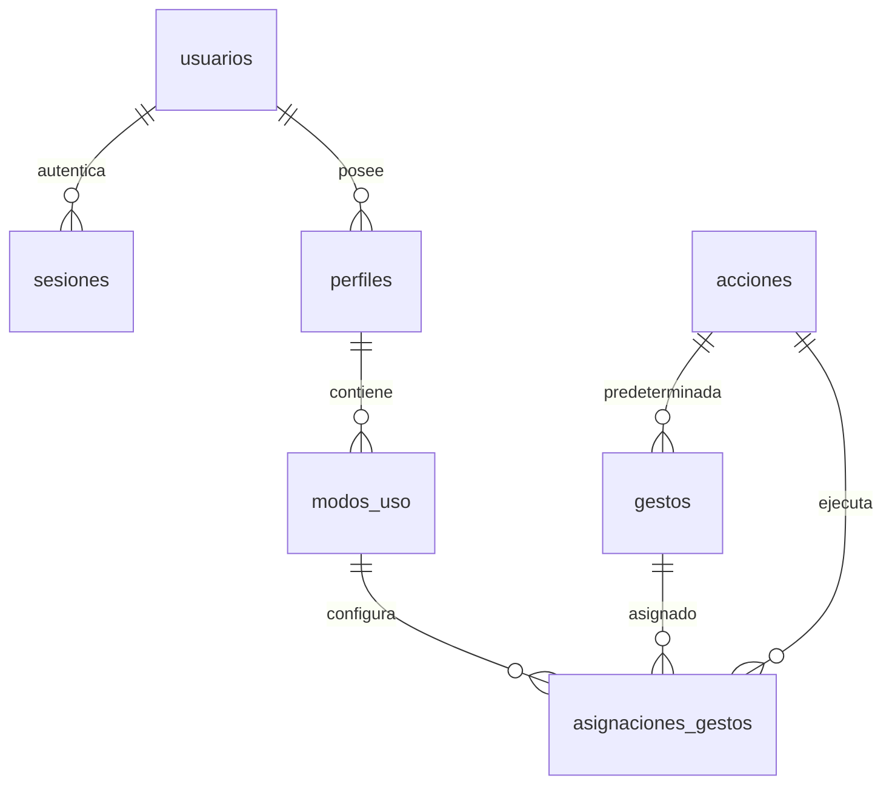

# Base nueva del Hito 2

Este esquema es independiente del backend antiguo de desktop/runtime. Fuente: diseño nuevo de siete tablas aportado por el equipo. No se importan cuentas ni configuraciones anteriores.

## Inicialización

Requiere Node 24 y las dependencias del backend. I2 debe declarar/fijar `better-sqlite3@13.0.3` y `argon2@0.45.1` en el manifiesto y lockfile; estas versiones están instaladas y se han podido cargar en el equipo de I1. Su presencia local no sustituye una instalación limpia.

1. Copiar `.env.example` de la raíz como `.env` y ajustar DATABASE_PATH a una ruta absoluta externa al repositorio y OneDrive.
2. Ejecutar desde la raíz `node backend/scripts/init-db.js`.
3. Ejecutar en una terminal interactiva `node backend/scripts/bootstrap-admin.js`. La contraseña se introduce oculta, no como argumento ni variable guardada.

El inicializador crea un archivo exclusivamente nuevo. Si ya existe, falla sin modificarlo. Si una inicialización falla después de crear el archivo, este se conserva para diagnóstico: no reintentar borrándolo automáticamente. Elegir otro nombre para una base nueva tras revisar el problema.

`openDatabase(filename, { initialize = false } = {})` abre la base existente. Verifica application_id `0x5a543032` y user_version `1`, activa FK, WAL y synchronous FULL. El consumidor debe cerrar la conexión con `close()` después de detener las peticiones. No usar una base activa sobre una carpeta sincronizada. Las restricciones de rutas resuelven ancestros existentes y enlaces; no constituyen una defensa frente a un usuario local malicioso con control del filesystem.

La versión 1 es de ESTE modelo nuevo, no la versión del esquema antiguo. No ejecutar schema.sql sobre una base previa. La base se identifica mediante application_id además del número de versión.

## Modelo

| Tabla | Clave | Contenido y reglas |
|---|---|---|
| usuarios | id TEXT UUID v4 NOT NULL | nombre_usuario único NOCASE, hash Argon2id, rol user/admin, estado activo/suspendido y fechas |
| sesiones | token_hash TEXT hexadecimal de 64 caracteres | FK usuario; creación/vencimiento válidos, vencimiento posterior |
| perfiles | id TEXT UUID v4 NOT NULL | FK usuario; nombre 1–60, descripción hasta 300, versión >=1; nombre único por usuario |
| modos_uso | id TEXT UUID v4 NOT NULL | FK perfil; nombre, categoría/plataforma, parámetros enteros 0–100, flags 0/1, versión y fechas |
| acciones | codigo TEXT NOT NULL | Identificador técnico estable y nombre; 17 referencias iniciales |
| gestos | codigo TEXT NOT NULL | Nombre y FK acción predeterminada; 13 referencias iniciales |
| asignaciones_gestos | modo_id + gesto_codigo | FK modo/gesto/acción; habilitado 0/1, versión y fecha |

Todas las tablas son STRICT. Se conservan CASCADE entre propietario/configuraciones y RESTRICT para catálogos utilizados. El borrado de un usuario elimina sesiones, perfiles, modos y asignaciones; no elimina catálogos. No existe todavía un endpoint para borrar usuarios.

Las fechas generadas por el código se expresan en ISO 8601 UTC. El SQL valida que las fechas sean interpretables por SQLite; no pretende reconocer criptográficamente hashes ni validar por sí solo toda regla de negocio.

Usuarios: identificador ASCII de 3–40 letras/números/guion bajo, convertido a minúsculas en el servicio. Esto permite una unicidad consistente con NOCASE. Nombres visibles de perfiles/modos admiten Unicode: I2 debe normalizar a NFC y trim; NOCASE solo equipara mayúsculas ASCII. Nombres con letras acentuadas de distinto caso pueden ser distintos: no prometer comparación Unicode completa ni introducir cambios de esquema sin coordinación.

I2 implementa actualización atómica de `version` y `actualizado_en` en sus CRUD. La presencia de esos campos no implementa sincronización. Asignación ausente usa el catálogo; asignación con habilitado=0 deshabilita. El motor solo puede ejecutar su lista de capacidades reales.

## Comprobación

`node --test backend/test/database/schema.test.js`

Las pruebas usan memoria y archivos temporales propios, nunca la base de desarrollo. Prueban integridad, cascadas, datos maliciosos como texto, creación exclusiva, reapertura y cierre. La demostración de reinicio completo de proceso queda a cargo de I3.
