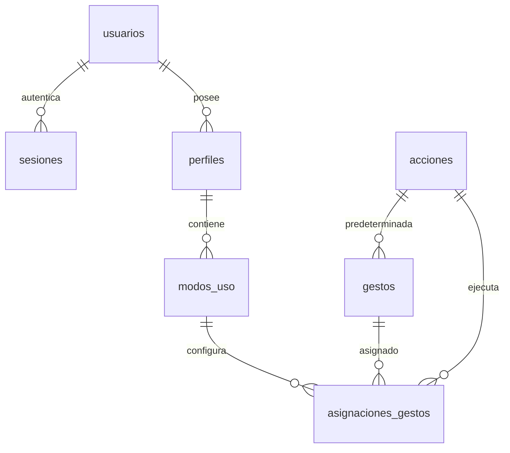

# Esquema SQLite del Hito 2

Esta entrega contiene únicamente el diseño reproducible de la base nueva de ZeroTouch. No incluye la base utilizada por el equipo, cuentas, contraseñas, sesiones, configuración privada ni el ejecutable Tauri. Tampoco incorpora todavía la integración del backend del Hito 2.

## Crear una base de prueba

`schema.sql` requiere SQLite 3.37.0 o posterior por el uso de tablas STRICT. Ejecutarlo exclusivamente en una base nueva y vacía, situada fuera del repositorio y de OneDrive. En DB Browser for SQLite: crear una base nueva, abrir la pestaña Ejecutar SQL, cargar `schema.sql`, ejecutar y guardar.

No ejecutar este archivo sobre una base existente: no es una migración y no utiliza DROP TABLE. Si falla la creación, revisar el error antes de cualquier nuevo intento. Para usarla desde una aplicación, activar `PRAGMA foreign_keys = ON` en cada conexión.

La base se identifica con `application_id = 1515466802` y `user_version = 1`. Esta versión pertenece al modelo nuevo y no indica compatibilidad con bases anteriores.

## Tablas

| Tabla | Clave | Propósito |
|---|---|---|
| usuarios | id UUID v4 | Identidad, hash de contraseña, rol user/admin y estado activo/suspendido |
| sesiones | token_hash | Hash de sesión, propietario y vencimiento |
| perfiles | id UUID v4 | Configuraciones propias de un usuario |
| modos_uso | id UUID v4 | Modos de un perfil, parámetros 0–100 y opciones booleanas |
| acciones | codigo | Catálogo de 17 acciones lógicas |
| gestos | codigo | Catálogo de 13 gestos y su acción predeterminada |
| asignaciones_gestos | modo_id + gesto_codigo | Sobrescrituras de acción y habilitación por modo |



El borrado de un usuario elimina sus sesiones y perfiles; los perfiles eliminan modos, y los modos eliminan asignaciones. Los catálogos referenciados se protegen con RESTRICT. Las tablas usan NOT NULL, tipos STRICT y restricciones de rangos, roles, estados y claves foráneas.

El SQL solo inserta los catálogos: usuarios, sesiones, perfiles, modos y asignaciones empiezan vacíos. Los nombres de columnas `contrasena_hash` y `token_hash` describen la estructura; no son credenciales ni contienen valores reales.

## Responsabilidades de la aplicación

La aplicación debe generar los UUID, validar entradas, calcular Argon2id, crear sesiones aleatorias y guardar únicamente su hash, comprobar propiedad y roles, parametrizar consultas y cerrar conexiones. El SQL no implementa por sí solo autenticación ni autorización.

Las fechas predeterminadas se generan en UTC. Las ediciones deben actualizar `actualizado_en` y comparar/incrementar `version` de forma atómica. NOCASE solo equipara mayúsculas ASCII; la normalización Unicode requiere validación en la aplicación.

No se almacenan vídeo, imágenes, puntos de manos ni texto Air-Swipe. Los catálogos y campos de funciones futuras no acreditan que esas funciones estén implementadas.

## Comprobación

Tras crear la base, estas consultas de lectura deben devolver `ok`, ninguna fila y siete tablas, respectivamente:

```sql
PRAGMA integrity_check;
PRAGMA foreign_key_check;
SELECT count(*) FROM sqlite_schema WHERE type = 'table';
```

Solo el archivo SQL y esta guía se versionan. Los archivos SQLite, sus auxiliares WAL/SHM, respaldos, claves y `.env` quedan excluidos mediante `.gitignore`.
