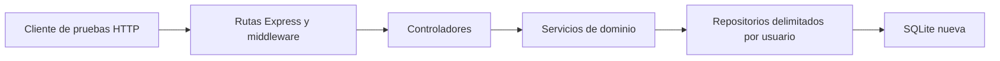

# Entrega I2 — API y arquitectura del Hito 2

## Estado y alcance

La aplicación principal integra los módulos de identidad de I1 con dos CRUD reales: perfiles y modos. Ya no es solamente una ruta de salud. Usa el SQL nuevo de siete tablas; no usa desktop/runtime ni modifica React.

Incluye lectura de catálogos y configuración gestual efectiva. No incluye editor de asignaciones, sincronización automática, motor Python, colección importable ni informe final: las últimas entregas de calidad/documentación se coordinan con I3.

La rama `codex/h2-api-recursos` parte de los commits locales de I1. No es una implementación paralela de autenticación ni una copia del backend anterior.

## Instalar y ejecutar desde cero

Requisitos comprobados localmente: Windows, Node 24.19.0 y npm. El manifiesto acepta Node 24.x; CI configura 24.19.0. Los módulos nativos better-sqlite3 13.0.3 y argon2 0.45.1 están declarados y fijados en el lockfile. dotenv y Express conservan sus rangos anteriores, con versiones exactas resueltas por el lockfile.

Desde la raíz:

```text
npm ci --prefix backend
```

Copiar `.env.example` de la RAÍZ a `.env` y ajustar DATABASE_PATH. Ejemplo de ruta de datos: `C:/Users/TU_USUARIO/AppData/Local/ZeroTouch/hito2.sqlite`. No utilizar una ruta dentro de OneDrive ni del repositorio. El antiguo backend/.env.example no es el archivo que carga el nuevo servidor; la configuración efectiva se resuelve siempre desde la raíz.

```text
npm run db:init --prefix backend
npm run admin:bootstrap --prefix backend
npm start --prefix backend
```

El inicializador no sobrescribe bases existentes. El bootstrap se realiza en terminal interactiva y solicita la contraseña oculta. No existe contraseña predeterminada. El servicio no inicializa ni migra bases al arrancar. Para desarrollo con reinicio del código: `npm run dev --prefix backend`.

Configuración:

| Variable | Regla |
|---|---|
| NODE_ENV | development, test o production |
| HOST | Loopback: 127.0.0.1, localhost o ::1 |
| PORT | Entero 0–65535; 3000 por defecto; 0 para puerto temporal en pruebas |
| DATABASE_PATH | Absoluta, local y externa al repositorio/OneDrive |
| APP_ORIGIN | Origen exacto sin ruta; HTTPS requerido para production |
| SESSION_TTL_SECONDS | Entero 60–86400; 28800 por defecto |

La demostración prevista es local sobre HTTP loopback. No hay despliegue HTTPS remoto ni proxy configurado. No activar production sobre HTTP esperando que las cookies funcionen. No se añaden permisos CORS universales.

## Arquitectura y decisiones



Monolito modular: un proceso y despliegue para identidad y configuraciones, módulos separados por responsabilidad. Es apropiado para tres estudiantes, una demostración local y carga pequeña aún no medida. Evita coordinar múltiples servicios y almacenamiento distribuido. Coste asumido: despliegue conjunto, un punto de fallo y sin escalado independiente.

Node/Express mantiene JavaScript en la parte web y permite expresar HTTP con middleware y rutas. Frente a FastAPI, reduce el cambio de lenguaje en la gestión web, aunque el motor Python seguirá separado. Express requiere definir validación, seguridad y estructura de forma explícita; no se supone que el framework las resuelva automáticamente.

SQLite evita operar un servidor de base adicional. Frente a PostgreSQL, reduce instalación y administración para esta entrega; se acepta un único escritor y dependencia del archivo local. WAL y timeout ayudan con bloqueos, pero no eliminan ese límite. Considerar PostgreSQL con carga concurrente medida, servicio remoto compartido o alta disponibilidad; no se afirma que migrar sea cambiar un driver.

El sistema completo sigue siendo híbrido: visión y acciones del SO quedan locales. La API administra preferencias; no recibe fotogramas ni participa en cada gesto. El catálogo es una configuración propuesta, no evidencia de reconocimiento gestual.

## Recorrido de una petición

`PATCH /api/v1/modos/:id`:

1. La composición valida formato/tamaño JSON y establece cabeceras seguras.
2. El middleware I1 verifica sesión, origen y CSRF; produce req.auth.
3. modosRoutes identifica el verbo y rechaza parámetros de consulta desconocidos.
4. modosController entrega ID, body e identidad al servicio, y formatea la respuesta.
5. modosService verifica existencia propia, campos permitidos, tipos/rangos y versión.
6. modosRepository actualiza con parámetros SQL, filtro por propietario y `WHERE version=?`; incrementa versión y actualiza fecha atómicamente.
7. Si la versión cambió, se devuelve 409. Si el recurso pertenece a otro usuario, 404. El administrador tampoco salta este filtro.

Las rutas/controladores no contienen SQL. Los repositorios no reciben un nombre de tabla del cliente. Los identificadores SQL dinámicos proceden exclusivamente de listas constantes; los valores usan parámetros.

## API implementada

Contrato completo: `docs/api/openapi.yaml` (OpenAPI 3.1, serialización JSON válida también como YAML 1.2). Tiene esquemas, seguridad, ejemplos, parámetros y errores. Base: `/api/v1`.

| Método | Ruta | Éxito | Acceso |
|---|---|---|---|
| GET | /health | 200 | Público |
| POST | /auth/registro | 201 | Público; limitado |
| POST | /auth/login | 200 | Público; limitado |
| GET | /auth/sesion | 200 | Sesión |
| POST | /auth/logout | 204 | Sesión + CSRF |
| GET, POST | /perfiles | 200, 201 | Propietario; CSRF en creación |
| GET, PATCH, DELETE | /perfiles/:id | 200, 200, 204 | Propietario; CSRF en mutaciones |
| GET, POST | /perfiles/:id/modos | 200, 201 | Propietario del perfil |
| GET, PATCH, DELETE | /modos/:id | 200, 200, 204 | Propietario a través del perfil |
| GET | /gestos | 200 | Sesión |
| GET | /acciones | 200 | Sesión |
| GET | /modos/:id/gestos | 200 | Propietario |
| GET | /admin/usuarios | 200 | Administrador |
| PATCH | /admin/usuarios/:id/rol | 200 | Administrador + CSRF |
| PATCH | /admin/usuarios/:id/estado | 200 | Administrador + CSRF |

Se mantiene exclusivamente `/api/health` como alias del sondeo inicial; el contrato nuevo responde `{data:{estado,servicio}}`. No existe API v2. Un verbo no soportado termina en 404 JSON, no en éxito ni HTML.

Listados de perfiles/modos/usuarios: limite 1–100 y offset >=0. Otros parámetros se rechazan en recursos I2. Catálogos completos son pequeños y no se paginan. GET individual, mutaciones y configuración no aceptan parámetros de consulta adicionales.

Creación de perfil:
```json
{"nombre":"Cocina","descripcion":"Consultar recetas"}
```

Creación de modo en el perfil obtenido:
```json
{"nombre":"Manual","sensibilidad_puntero":65,"estabilizacion_puntero":40,"tolerancia_micro_pinza":50}
```

Edición posterior:
```json
{"sensibilidad_puntero":70,"version":1}
```

POST devuelve 201, `{data: recurso}` y Location. PATCH devuelve la versión incrementada. DELETE devuelve 204 sin cuerpo. Listados: `{data:[],paginacion:{limite,offset}}`.

Errores: `{error:"CODIGO",mensaje:"Texto seguro"}`. 400 por entrada, 401 por sesión, 403 por rol/origen/CSRF, 404 por ausencia/propiedad ajena, 409 por nombre o versión, 413 por más de 16 KB, 415 por formato/codificación/compresión no admitidos, 429 por autenticación limitada, 500 genérico, 503 por bloqueo temporal SQLite. Nunca se devuelven stacks, SQL ni secretos.

Reglas: registro siempre user; nombres de cuenta ASCII normalizados; nombres visibles NFC y trim. Unicidad NOCASE conserva la limitación ASCII documentada por I1. Versiones y parámetros numéricos son enteros. Cambiar propietario/ID/perfil padre/fechas por body está prohibido. Borrar perfil elimina modos y asignaciones por cascada. No hay borrado general de cuentas en este alcance.

## Configuración para el motor de I3

`GET /api/v1/modos/:id/gestos` devuelve:

```text
{data:{formato_version:1,modo:{...},gestos:[
  {gesto_codigo,nombre,accion_codigo,habilitado,asignacion_version}
]}}
```

La lectura de modo y asignaciones usa una transacción de lectura para obtener un estado coherente. Una asignación sobreescribe acción/habilitación; si falta, se usa el catálogo con habilitado=true y asignacion_version=null. I3 exporta solamente `data` a JSON, nunca cookies/CSRF, y ejecuta solo las acciones soportadas por su motor. No se implementó editor HTTP de asignaciones: las pruebas insertan overrides directamente en una base de test.

## Gestión de recursos y calidad

createApp({db,config}) no abre puertos ni inicializa datos al importarse. startServer abre la conexión existente, escucha en loopback y establece timeouts. SIGINT/SIGTERM cierran HTTP, conexiones inactivas y SQLite; tras cinco segundos se cierran conexiones HTTP restantes. El canal IPC de pruebas admite shutdown y anuncia el puerto asignado, sin credenciales. El cierre es idempotente.

Comandos:

```text
npm test --prefix backend
npm run lint
```

Las pruebas de recursos cubren ambos CRUD, lectura individual/listas, valores predeterminados, booleanos, cascadas, duplicados, entrada SQL como dato, validación, propiedad ante otro user y admin, versión concurrente, configuración efectiva, JSON/formato/tamaño, sesión/CSRF y errores internos seguros. La prueba de servidor usa procesos Node reales y una base temporal: fuerza bloqueo con otra conexión, espera 503, cierra, arranca un proceso nuevo y comprueba el modo persistido.

Resultado de esta entrega: **23 pruebas aprobadas, 0 fallos**, ejecutadas también en una copia limpia sin node_modules previo tras `npm ci`. Se instalaron 82 paquetes y se comprobó carga real de SQLite/Argon2 mediante la suite. npm avisó que sus scripts de instalación no estaban autorizados explícitamente en allowScripts; los módulos incluidos cargaron en este Windows. No se habilitaron scripts globalmente: una plataforma que necesite compilarlos debe revisar esa política de forma específica. Esta comprobación no equivale a instalación en otro computador.

Análisis estático: cero errores y una advertencia previa de useEffect en App.jsx. Contrato OpenAPI leído y referencias internas verificadas: 15 rutas y 21 operaciones. git diff --check sin errores.

ESLint distingue fuentes React y Node. Excluye artefactos, copias temporales y worktrees ajenos. No se modificó App.jsx para ocultar su advertencia previa de dependencias de useEffect. El workflow test.yml instala y ejecuta la suite del backend; su ejecución remota solo puede confirmarse después de publicar y correr GitHub Actions.

## Pendientes de equipo y límites

- I3: colección, evidencia/guion de demo, motor, informe final y README consolidado.
- Revisión cruzada de este código y ejecución en otro computador.
- La prueba de instalación limpia en este equipo no equivale a otro sistema operativo.
- Sin despliegue público, cifrado completo del archivo, validación de rendimiento ni integración React.
- No incluir artefactos locales existentes, datos o node_modules en los commits.

## Referencias verificadas y uso de IA

- Express. (s. f.). Error handling. https://expressjs.com/en/guide/error-handling/
- Express. (s. f.). Production best practices: Security. https://expressjs.com/en/advanced/best-practice-security/
- npm. (s. f.). npm ci. https://docs.npmjs.com/cli/v11/commands/npm-ci/
- SQLite. (s. f.). STRICT Tables. https://www.sqlite.org/stricttables.html
- WiseLibs. (s. f.). better-sqlite3 API. https://github.com/WiseLibs/better-sqlite3/blob/master/docs/api.md

La documentación de Express fundamenta el tratamiento de errores síncronos y promesas mediante middleware; npm ci sustenta la instalación reproducible desde lockfile; SQLite y better-sqlite3 fundamentan tipos/transacciones. Codex asistió en implementación, contrato y pruebas. Los integrantes deben revisar el diff y explicar las decisiones antes de la defensa.
