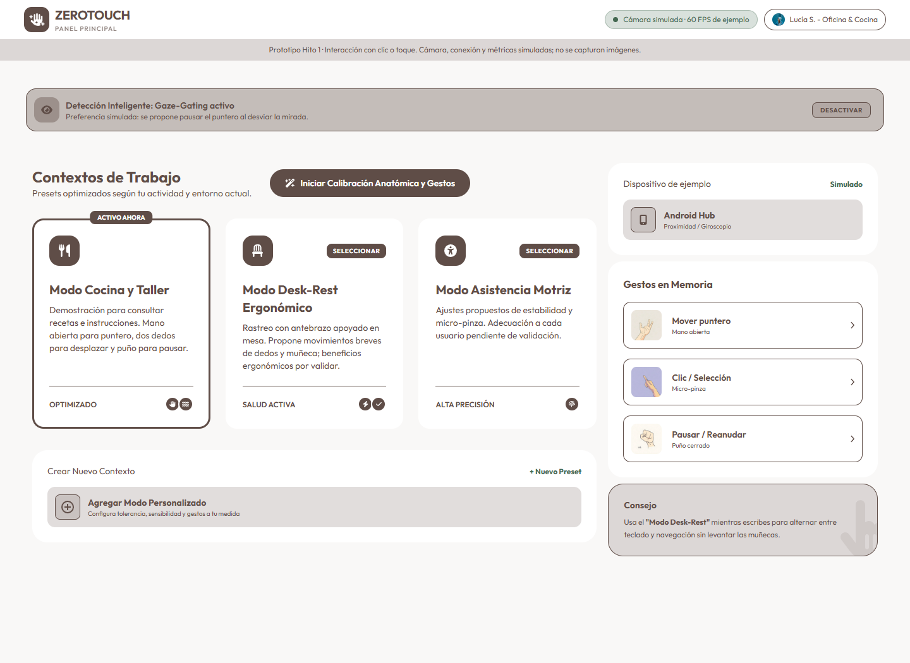
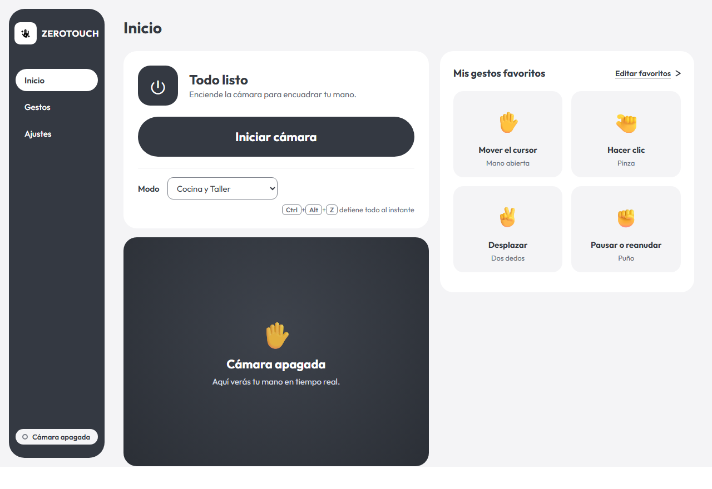
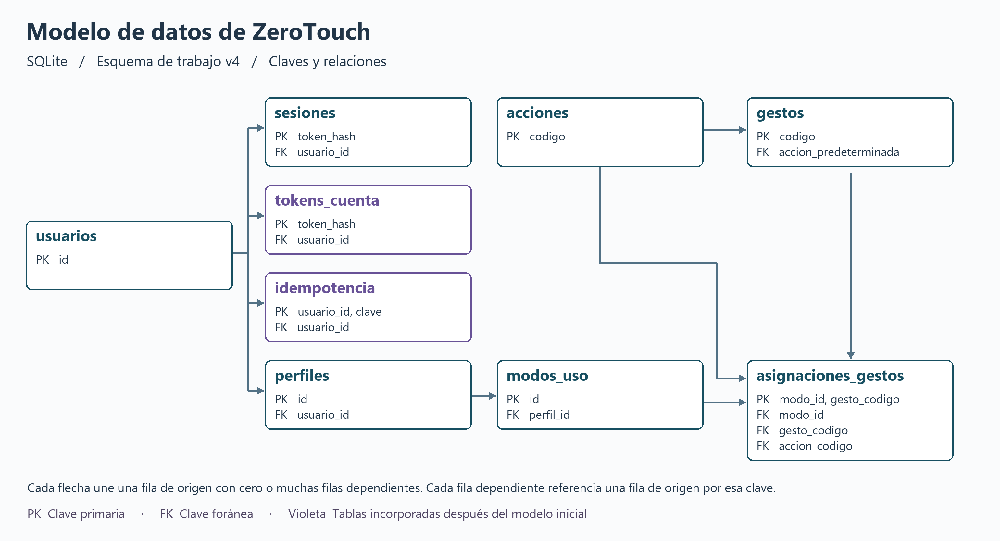
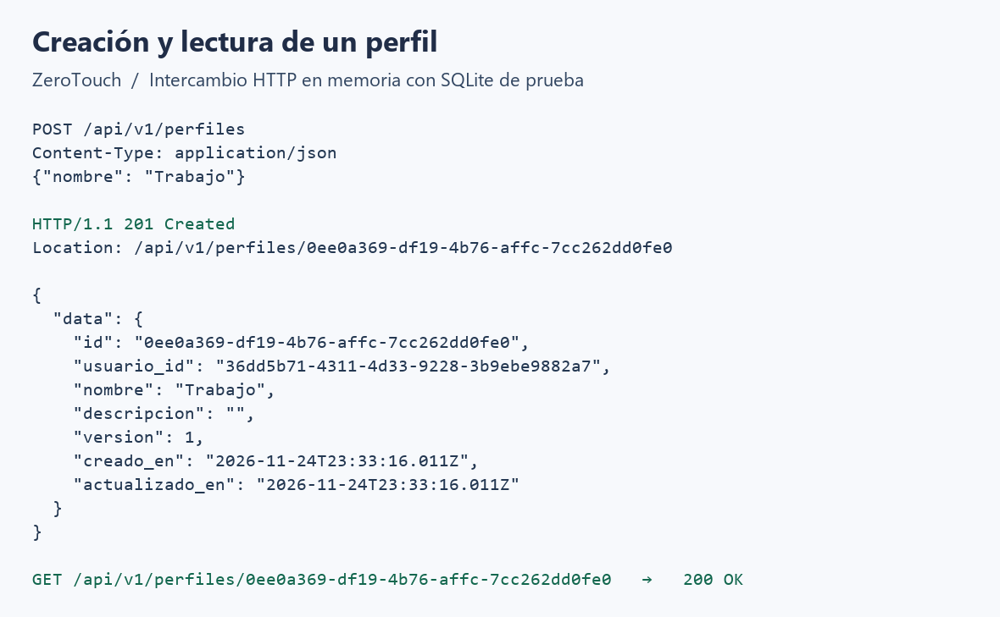

# ZeroTouch - Hito 2: backend y verificación integral

Universidad Mayor. Arquitectura y Desarrollo (móvil y web). Integrantes: Julietta Céspedes, Adan Mendoza y Anais Perez. Fecha: 2 de noviembre de 2026.

## 1. Introducción

ZeroTouch busca que una persona pueda interactuar con su computador mediante gestos mientras realiza una tarea manual. En el Hito 1 se presentó un prototipo de interfaz que mostraba cómo el usuario elegiría y personalizaría sus modos de uso. Para dar continuidad a esa propuesta, el Hito 2 abordó una pregunta concreta: ¿cómo conservar la configuración de cada persona y recuperarla la próxima vez que utilice la aplicación?

El objetivo de este hito fue implementar un backend que permitiera a cada usuario autenticarse y crear, consultar, modificar y eliminar sus perfiles y modos de uso. El servidor se desarrolló con Node.js y Express y utiliza SQLite para guardar los datos. Así, un ajuste como la sensibilidad del puntero queda asociado a un modo específico y puede recuperarse en una sesión posterior.

Este informe describe los cambios respecto del prototipo, el diseño de la API, el recorrido de una petición por las capas del servidor y el modelo de datos. También presenta las pruebas utilizadas para comprobar la persistencia de las configuraciones y el control de acceso entre cuentas.

## 2. Continuidad y cambios respecto del Hito 1

El prototipo del Hito 1 mostraba cómo una persona podría controlar el computador mediante gestos y adaptar su uso a distintas actividades (Equipo ZeroTouch, 2026). En el Hito 2 se desarrolló el backend que permite conservar esa configuración. En las revisiones posteriores se simplificaron la interfaz y el repertorio de gestos, y se definió Windows como plataforma de la entrega.

**Persistencia de la configuración.** En el prototipo, los modos de uso contenían datos de ejemplo. Con el backend desarrollado en Node.js y Express, cada usuario puede crear perfiles y guardar sus modos en SQLite. Así, al ajustar la sensibilidad del puntero en el modo *Asistencia Motriz*, el valor se conserva entre sesiones y los demás modos mantienen su propia configuración.

**Rediseño de la interfaz.** La pantalla inicial del prototipo daba prioridad a la selección del contexto de trabajo. El rediseño reunió en **Inicio** los controles necesarios para comenzar una sesión: selección del modo, activación de la cámara y consulta de los gestos favoritos. La vista previa permite comprobar el encuadre de la mano, mientras que el atajo **Ctrl + Alt + Z** permanece visible junto al selector de modo para detener el control gestual.

*Figura 1. Pantalla principal del prototipo del Hito 1, organizada por contextos de trabajo.*

*Figura 2. Pantalla de inicio de la aplicación de escritorio tras el rediseño.*

**Reducción y ajuste de gestos.** Durante el desarrollo se identificaron movimientos que podían confundirse entre sí. Por ejemplo, desplazar rápidamente la mano para mover el cursor podía activar el barrido asignado a la acción de retroceder. Se retiraron los barridos laterales y se ajustó la duración de la pinza para distinguir el clic del arrastre: un contacto breve hace clic y mantenerlo durante aproximadamente **0,9 segundos** permite iniciar el arrastre.

La revisión redujo el catálogo de escritorio de **22 a 10 entradas visibles**. Se retiraron once gestos, entre ellos los pulgares para confirmar o cancelar y la sacudida lateral para recorrer pestañas. El trazo Air‑Swipe se conservó dentro del teclado. En la captura del rediseño (Figura 2) aparecen cuatro favoritos: mover el cursor, hacer clic, desplazar y pausar o reanudar.

**Alcance de la entrega.** La propuesta inicial contemplaba un componente móvil, representado en el prototipo mediante un dispositivo *Android Hub* simulado. Durante el desarrollo se retiró la versión móvil de la entrega para concentrar la integración y las pruebas en la aplicación de escritorio y el control gestual de Windows.

## 3. Arquitectura y tecnologías

ZeroTouch utiliza un **monolito modular** para su backend. La autenticación, los perfiles y los modos de uso se ejecutan en un mismo proceso, con módulos separados para cada responsabilidad. Esta decisión simplifica la instalación local y el mantenimiento individual del proyecto: basta con iniciar un servidor para disponer de toda la API. A cambio, esos módulos se despliegan juntos y, si el servidor se detiene, todos dejan de atender solicitudes.

**Node.js y Express** permiten implementar la API en JavaScript. Node.js proporciona el entorno de ejecución de JavaScript del servidor (Node.js, s. f.). Express dirige cada solicitud a la operación correspondiente. Por ejemplo, cuando una persona cambia la sensibilidad del puntero, el backend recibe la petición, comprueba que el modo pertenece a su cuenta y valida el nuevo valor antes de guardarlo. Estas reglas se implementaron en el proyecto y se comparten entre los clientes que consumen la API.

**SQLite** almacena las cuentas y sus configuraciones en un archivo local. El backend accede a los datos mediante `better-sqlite3`, lo que evita instalar y administrar un servidor de base de datos adicional. Esta elección se ajusta al uso previsto en un equipo de escritorio, aunque limita la escritura a una operación a la vez. El motor gestual en Python carga la configuración del modo y procesa la cámara localmente, de modo que mover el cursor no requiere una petición al servidor por cada fotograma.

### 3.1. Recorrido de una petición por las capas del backend

Express asocia cada combinación de método HTTP y ruta con una función que atiende la solicitud (Express, s. f.). Cuando un usuario crea el perfil *Trabajo*, el cliente envía `POST /api/v1/perfiles` con el cuerpo `{"nombre":"Trabajo"}`. El servidor obtiene la identidad del usuario a partir de su sesión. Así, el cliente indica el nombre del perfil y el backend se encarga de asociarlo a la cuenta correspondiente.

| Capa | Archivo dentro de `backend/src/` | Responsabilidad al crear el perfil |
|---|---|---|
| Ruta | `routes/perfilesRoutes.js` | Reconoce la petición `POST` y la dirige al controlador de perfiles. |
| Controlador | `controllers/perfilesController.js` | Toma el identificador del usuario autenticado y pasa los datos recibidos al servicio. |
| Servicio | `services/perfilesService.js` | Valida los campos y genera un identificador único para el nuevo perfil. |
| Repositorio | `repositories/perfilesRepository.js` | Ejecuta una consulta parametrizada que guarda en SQLite el nombre del perfil y el identificador de su propietario. |

La Figura 3 muestra el resultado de este recorrido. Una vez guardado *Trabajo*, el servidor devolvió **`201 Created`** e indicó la dirección del nuevo perfil en la cabecera `Location`. Al consultar esa dirección, la API respondió **`200 OK`** y devolvió el mismo identificador y nombre. Así se comprobó tanto la creación como la lectura del recurso.

## 4. Modelo de datos y persistencia

El perfil *Trabajo*, creado en el ejemplo anterior, pertenece a una cuenta y puede contener varios modos de uso. Esa relación organiza la base de datos de ZeroTouch: **el usuario es dueño del perfil y cada modo conserva sus propios ajustes**. Así, una persona puede cambiar la sensibilidad del puntero en *Asistencia Motriz* y mantener otra configuración en un segundo modo.

El modelo inicial del Hito 2 se organizó en siete tablas:

| Tabla | Qué conserva | Clave o relación principal |
|---|---|---|
| `usuarios` | La cuenta, el nombre de usuario, el hash de la contraseña, el rol y el estado. | `id` identifica de forma única cada cuenta. |
| `sesiones` | El hash del token de sesión y su fecha de expiración. | `token_hash` identifica la sesión y `usuario_id` la vincula con su cuenta. |
| `perfiles` | El nombre, la descripción y la versión de cada perfil. | `usuario_id` identifica al propietario. El nombre del perfil es único dentro de esa cuenta. |
| `modos_uso` | Los ajustes de cada modo, como sensibilidad, estabilización y tolerancia de la micro‑pinza. | `perfil_id` vincula el modo con su perfil. |
| `gestos` | Los gestos del catálogo y la acción predeterminada de cada uno. | `codigo` identifica el gesto y `accion_predeterminada` referencia una acción. |
| `acciones` | Las operaciones que pueden asignarse a un gesto, como hacer clic, desplazar o pausar. | Cada acción tiene un `codigo` único. |
| `asignaciones_gestos` | La acción elegida para un gesto en un modo y si está habilitado. | La clave compuesta `(modo_id, gesto_codigo)` permite una sola asignación por gesto dentro de cada modo. |

**Integridad de los datos.** Los identificadores de usuarios, perfiles y modos son UUID almacenados como texto. Las tablas emplean el modo STRICT de SQLite para controlar los tipos de datos (SQLite, s. f.-b). El esquema de ZeroTouch limita los ajustes numéricos a enteros entre 0 y 100, y las opciones booleanas se guardan como `0` o `1`. Las claves foráneas mantienen las relaciones entre tablas y permiten definir borrados en cascada (SQLite, s. f.-a). Por ejemplo, al eliminar el perfil *Trabajo*, SQLite elimina en cascada sus modos y las asignaciones correspondientes. Los catálogos compartidos de gestos y acciones se conservan.

**Persistencia y evolución.** El archivo `db/schema.sql` permite crear una base nueva. La aplicación localiza la base mediante `DATABASE_PATH`, y el repositorio incluye un `.env.example` con las variables necesarias para configurarla. En revisiones posteriores se incorporaron `tokens_cuenta`, para verificar el correo y recuperar la contraseña, e `idempotencia`, para evitar que un reintento de creación duplique un perfil o un modo. Con estas ampliaciones, el esquema actual contiene **nueve tablas**.

*Figura 4. Modelo entidad–relación de ZeroTouch. Las tablas en violeta corresponden a las ampliaciones posteriores al diseño inicial del Hito 2.*

## 5. API y seguridad

### 5.1. Diseño y versionado de la API REST

La aplicación de escritorio se comunica con el backend mediante una API REST. Cada recurso tiene una dirección y el método HTTP indica la operación que se quiere realizar. En el caso del perfil *Trabajo*, el cliente envía `POST /api/v1/perfiles` para crearlo. El servidor responde con `201 Created` y entrega en la cabecera `Location` la dirección del nuevo perfil. A partir de ese momento, el cliente puede usar esa misma dirección para consultarlo, modificarlo o eliminarlo.

ZeroTouch distingue dos tipos de versión. El prefijo **`/api/v1`** identifica la versión del contrato que utiliza el cliente. El campo **`version`** de cada perfil o modo indica cuántas revisiones lleva ese registro. Por ejemplo, si dos clientes abren *Trabajo* en la versión 1 y uno guarda un cambio, el perfil pasa a la versión 2. Si el segundo intenta guardar con la versión anterior, el servidor responde con `409 Conflict`. Así se evita que una edición sobrescriba silenciosamente a la otra.

Prefijo `/api/v1`. Éxito `{data:...}`; listados añaden paginacion con limite/offset; error `{error:CODIGO,mensaje:...}`. Creación 201, lectura/edición 200 y borrado/logout 204. El contrato OpenAPI documenta 23 rutas y 30 operaciones. Salud pública; registro y login públicos; recursos y administración requieren sesión.

Registro crea user activo. Argon2id protege contraseñas con parámetros explícitos. Login entrega cookie de sesión opaca y token CSRF; SQLite conserva el hash del token de sesión, no el original. HttpOnly, SameSite=Strict y Secure según HTTPS/producción limitan exposición. Mutaciones requieren X-CSRF-Token y validan Origin cuando existe. Roles y suspensión revocan sesiones; no se permite eliminar al último administrador activo mediante esos cambios.

Propiedad se deriva de la sesión y delimita todas las consultas de recursos. Un admin administra cuentas, pero no obtiene acceso general a perfiles ajenos. Recurso inexistente o ajeno devuelve 404. El primer admin se crea por CLI interactiva sin contraseña en argumentos. Se aplican límites de autenticación en memoria para un único proceso; un reinicio restablece contadores. La base completa no está cifrada y no se ha realizado despliegue remoto.

La exportación `GET /modos/:id/gestos` devuelve formato_version 1, modo y gestos efectivos, con booleanos JSON. Una asignación prevalece sobre el catálogo y habilitado=false deshabilita. No incluye credenciales.

### 5.2. Operaciones sobre perfiles

La API permite que cada usuario cree y administre sus perfiles. Todas las rutas de la tabla comienzan con `/api/v1` y requieren una sesión válida. Para crear, editar o eliminar un perfil, el cliente también debe enviar la cabecera `X-CSRF-Token`.

| Operación | Método y ruta | Parámetros o cuerpo de ejemplo | Respuesta correcta | Errores principales |
|---|---|---|---|---|
| Listar perfiles | `GET /perfiles` | `?limite=20&offset=0` | `200 OK` con los perfiles del usuario y los datos de paginación. | `400` si la paginación es inválida. |
| Crear un perfil | `POST /perfiles` | `{"nombre":"Trabajo"}`. La descripción es opcional. | `201 Created` con el perfil creado y su dirección en `Location`. | `400` si faltan datos obligatorios y `409` si el usuario ya tiene un perfil con ese nombre. |
| Consultar un perfil | `GET /perfiles/{id}` | `{id}` es el identificador del perfil. | `200 OK` con el perfil y una etiqueta de estado en la cabecera `ETag`. | `404` si el perfil no existe o pertenece a otra cuenta. |
| Editar un perfil | `PATCH /perfiles/{id}` | `{"nombre":"Trabajo diario","version":1}` | `200 OK` con el perfil actualizado y su nueva versión. | `409` si la versión quedó desactualizada o el nombre ya está en uso en esa cuenta. |
| Eliminar un perfil | `DELETE /perfiles/{id}` | Cabecera `If-Match` con el `ETag` obtenido al consultar el perfil. | `204 No Content`. Se eliminan también sus modos y asignaciones. | `428` si falta `If-Match` y `412` si el perfil o sus modos cambiaron desde la consulta. |

La Figura 3 documenta las operaciones de creación y consulta con el perfil *Trabajo*. El borrado tiene una protección adicional porque afecta también a sus modos: si uno cambió después de la consulta, el servidor conserva el perfil y pide al cliente que vuelva a leer su estado antes de eliminarlo.

### 5.3. Operaciones sobre modos de uso

Dentro del perfil *Trabajo*, el usuario puede crear un modo llamado *Lectura* y ajustar la sensibilidad del puntero para esa actividad. La API utiliza el identificador del **perfil** para listar o crear sus modos. Una vez creado, cada modo tiene su **propio identificador** para consultarlo, editarlo o eliminarlo.

| Operación | Método y ruta | Parámetros o cuerpo de ejemplo | Respuesta correcta | Errores principales |
|---|---|---|---|---|
| Listar modos | `GET /perfiles/{id}/modos` | ID del perfil. Paginación opcional con `?limite=20&offset=0`. | `200` con los modos del perfil y los datos de paginación. | `400` por paginación inválida. `404` si el perfil no existe o pertenece a otra cuenta. |
| Crear un modo | `POST /perfiles/{id}/modos` | `{"nombre":"Lectura","sensibilidad_puntero":40}` | `201` con el modo creado y su dirección en `Location`. | `400` si la sensibilidad está fuera del rango de 0 a 100. `409` si el nombre ya existe en ese perfil. |
| Consultar un modo | `GET /modos/{id}` | ID del modo. | `200` con los ajustes y la cabecera `ETag`, que identifica el estado consultado. | `404` si el modo no existe o pertenece a otra cuenta. |
| Editar un modo | `PATCH /modos/{id}` | `{"sensibilidad_puntero":55,"version":1}` | `200` con la sensibilidad actualizada y la versión `2`. | `400` por un valor inválido. `409` si otra edición ya cambió la versión. |
| Eliminar un modo | `DELETE /modos/{id}` | Cabecera `If-Match` con el `ETag` de la consulta. | `204` sin cuerpo. Se eliminan el modo y sus asignaciones. | `428` si falta `If-Match` y `412` si el modo o sus asignaciones cambiaron desde la consulta. |

Todas las rutas usan el prefijo `/api/v1` y requieren una sesión válida. Las operaciones de creación, edición y borrado también requieren `X-CSRF-Token`.

### 5.4. Configuración de gestos por modo

En el modo *Lectura*, el usuario puede mantener el desplazamiento con dos dedos y asignar otra función a la palma abierta. La API combina las acciones predeterminadas del catálogo con las preferencias guardadas para ese modo. El resultado es la **configuración efectiva**: indica qué acción corresponde a cada gesto y si está habilitada.

| Operación | Método y ruta | Parámetros o cuerpo de ejemplo | Respuesta |
|---|---|---|---|
| Consultar los gestos y las acciones disponibles | `GET /gestos` y `GET /acciones` | Paginación opcional con `?limite=20&offset=0`. | `200` con el catálogo solicitado. |
| Consultar qué acciones admite cada gesto | `GET /capacidades` | Sin cuerpo. | `200` con las combinaciones permitidas. La interfaz usa esta información para ofrecer opciones compatibles. |
| Leer la configuración de un modo | `GET /modos/{id}/gestos` | ID del modo. | `200` con el modo, su versión y la configuración efectiva de sus gestos. |
| Cambiar una asignación | `PATCH /modos/{id}/gestos/palma_abierta` | `{"accion_codigo":"precision","version":2}` | `200` con la configuración actualizada. Las demás asignaciones se conservan. |
| Restablecer los valores predeterminados | `PUT /modos/{id}/gestos` | `{"version":3,"gestos":[]}` | `200` con los valores del catálogo. Esta operación reemplaza todas las asignaciones del modo; una lista vacía retira todas las personalizaciones. |

El modo y sus asignaciones comparten un número de versión. En el ejemplo, cambiar la acción de la palma lleva el modo de la versión `2` a la `3`. Si otro cliente intenta editar usando todavía la versión `2`, recibe `409 Conflict`. Una combinación que el motor no admite recibe `400`; consultar un modo ajeno devuelve `404`. Todas las rutas requieren sesión y las modificaciones también exigen `X-CSRF-Token`.

### 5.5. Autenticación y seguridad de las cuentas

Para acceder al perfil *Trabajo*, el servidor primero debe identificar a su propietario. El proceso comienza con el registro y la verificación del correo. Después, el usuario puede iniciar sesión con su nombre de usuario o correo y su contraseña. A partir de ese momento, la aplicación utiliza una cookie de sesión para consultar sus perfiles y modos.

| Operación | Método y ruta | Datos enviados | Respuesta principal |
|---|---|---|---|
| Registrar una cuenta | `POST /auth/registro` | Nombre de usuario, correo y contraseña. | `202`: se recibe la solicitud y queda pendiente la verificación del correo. |
| Verificar el correo | `POST /auth/verificacion` | Token recibido por correo. | `200` si se confirma la dirección. Un token inválido o vencido devuelve `400`. |
| Reenviar la verificación | `POST /auth/verificacion/reenviar` | Correo de la cuenta. | `202` con un mensaje genérico que protege la privacidad de la cuenta. |
| Corregir un correo pendiente de verificación | `POST /auth/correo` | Credenciales de la cuenta y nuevo correo. | `202` si se acepta la solicitud. |
| Iniciar sesión | `POST /auth/login` | Nombre de usuario o correo y contraseña. | `200` con los datos del usuario y el token CSRF. Las credenciales inválidas reciben `401`. |
| Consultar la sesión | `GET /auth/sesion` o `GET /auth/me` | Cookie de sesión. | `200` con la identidad del usuario y el token CSRF, o `401` si la sesión es inválida. |
| Recuperar la contraseña | `POST /auth/contrasena/olvido` y `POST /auth/contrasena/restablecer` | Primero se envía el correo. Después, el token recibido y la nueva contraseña. | La solicitud devuelve `202`. El restablecimiento correcto devuelve `200` y revoca las sesiones anteriores. |
| Cerrar sesión | `POST /auth/logout` | Cookie de sesión y cabecera `X-CSRF-Token`. | `204` sin cuerpo. La sesión deja de ser válida. |

**Protección de credenciales.** ZeroTouch guarda un hash de la contraseña generado con Argon2id. Al iniciar sesión, entrega una cookie `HttpOnly`, que el navegador envía al servidor y que el código JavaScript de la página no puede leer. SQLite conserva únicamente el hash del token de sesión. Para modificar datos, el cliente debe presentar además el token CSRF.

**Acceso por propietario.** Si otra cuenta intenta abrir el perfil *Trabajo* usando su identificador, la API responde `404`. Así protege tanto el contenido como la existencia del perfil. El rol administrador permite gestionar el estado y el rol de las cuentas, mientras que sus configuraciones gestuales siguen siendo privadas.

Todas las rutas de la tabla utilizan el prefijo `/api/v1`.

### 5.6. Administración de usuarios

El administrador puede consultar la lista de cuentas, asignar roles y suspender o reactivar usuarios. Estos permisos se limitan a la gestión de cuentas. Los perfiles, modos y configuraciones gestuales siguen sujetos a las reglas de propiedad descritas en el apartado anterior.

| Operación | Método y ruta | Parámetros o cuerpo de ejemplo | Respuesta |
|---|---|---|---|
| Listar usuarios | `GET /admin/usuarios` | `?limite=20&offset=0` | `200` con la lista paginada. Una cuenta sin rol administrativo recibe `403`. |
| Cambiar el rol | `PATCH /admin/usuarios/{id}/rol` | `{"rol":"admin"}`. Admite `user` o `admin`. | `200` con los datos actualizados. Un rol inválido devuelve `400`. |
| Suspender o reactivar una cuenta | `PATCH /admin/usuarios/{id}/estado` | `{"estado":"suspendido"}`. Admite `activo` o `suspendido`. | `200` con el nuevo estado. Si la cuenta indicada no existe, devuelve `404`. |

Todos los endpoints usan el prefijo `/api/v1` y requieren una sesión de administrador. Las dos operaciones `PATCH` también exigen la cabecera `X-CSRF-Token`.

Al suspender una cuenta, el servidor actualiza su estado y revoca sus sesiones en una misma transacción. De este modo, una persona que ya tenía la aplicación abierta pierde el acceso en su siguiente petición protegida. Un cambio de rol también revoca las sesiones de la cuenta afectada.

El sistema conserva siempre una vía de administración: si se intenta suspender al **último administrador activo** o cambiar su rol a `user`, la API rechaza la operación con `409 Conflict` y el código `ULTIMO_ADMIN`. La primera cuenta administradora se crea mediante una herramienta local y debe verificar su correo antes de iniciar sesión.

## 6. Implementación y verificación

### 6.1. Verificación de la base de datos

El 24 de noviembre de 2026 se ejecutaron doce pruebas automáticas sobre bases SQLite de prueba. Todas finalizaron correctamente. Se comprobaron tres aspectos del modelo relevantes para el uso de ZeroTouch:

| Aspecto | Qué se comprobó |
|---|---|
| **Validez de la configuración** | SQLite rechazó valores fuera de rango, fracciones en campos enteros y referencias a registros inexistentes. Así, un modo solo puede guardarse si pertenece a un perfil válido y sus ajustes cumplen las restricciones. |
| **Borrado de un perfil** | Al eliminar un perfil también se eliminaron sus modos y asignaciones. Los catálogos compartidos de gestos y acciones quedaron disponibles para los demás perfiles. |
| **Actualización de una base existente** | La migración a la versión 4 creó un respaldo y retiró los gestos eliminados del catálogo junto con sus asignaciones. Los demás ajustes del modo se conservaron. Otra prueba provocó un fallo durante la migración y verificó que la base mantuvo su versión y sus tablas anteriores. |

Ese mismo día, la ejecución general del backend (`npm test --prefix backend`) registró 91 pruebas aprobadas y ninguna fallida, y la prueba de integración de la colección también se aprobó. Una de las pruebas del servidor detiene el proceso, inicia otro sobre el mismo archivo SQLite y comprueba que la sensibilidad del puntero guardada en un modo se recupera.

La misma recuperación se comprobó con la aplicación de escritorio (`npm run verify:hito3`, 10 comprobaciones correctas de 10): la velocidad del cursor del modo *Cocina y Taller* se cambió de 70 a 55 en la interfaz, se leyó directamente en el archivo SQLite y se mantuvo después de cerrar y volver a iniciar el servidor. La comprobación usa cuentas ficticias y una base temporal, y no abre la cámara.

### 6.2. Verificación de la API: creación y consulta de un perfil

La Figura 3 muestra el recorrido del perfil *Trabajo*. Primero, el cliente envió `POST /api/v1/perfiles` con el nombre del perfil. El servidor respondió `201 Created` y devolvió en la cabecera `Location` la dirección asignada al nuevo recurso.

A continuación, el cliente consultó esa dirección mediante `GET`. La API respondió `200 OK` y devolvió el mismo identificador y nombre. Esto permitió comprobar que la dirección entregada al crear el perfil servía para recuperar el registro correcto. La prueba se realizó con una cuenta ficticia y una base SQLite en memoria.

*Figura 3. Registro de una prueba con la aplicación Express y SQLite en memoria. La creación del perfil Trabajo devolvió 201 Created y la consulta de la ruta indicada en Location devolvió 200 OK con el mismo perfil.*

#### Antecedentes del informe del 2 de noviembre de 2026

I1 aportó SQL, conexión, autenticación y administración. I2 integró aplicación, CRUD, contrato y automatización. I3 agregó colección y prueba de extremo a extremo, consolidando evidencias sin modificar producción ajena. La colección tiene 24 solicitudes, variables locales para datos ficticios y comprobación de códigos HTTP. La integración ejecuta esas solicitudes contra el servidor de producto, con un adaptador acotado de scripts Postman.

La suite conjunta obtuvo 25 pruebas aprobadas, cero fallos. Se comprueban integridad, autenticación, expiración/revocación, roles, CSRF, acceso A a B, duplicados, tipos/rangos, conflictos de versión, errores de formato/tamaño y bloqueo SQLite. Para persistencia se termina el proceso con salida 0, se arranca otro PID sobre el mismo archivo y se recuperan modo y sesión. Esta evidencia supera una simple reapertura de conexión dentro del mismo proceso.

La prueba I3 verifica también el contenido del DTO exportado y ausencia de credenciales. No requiere Python ni cámara. El servidor escucha solo en loopback, usa cuentas ficticias y elimina exclusivamente la carpeta temporal creada por cada prueba. No hay endpoints de bypass para facilitar el recorrido.

Quedan pendientes importación manual en Postman, revisión por otro integrante, instalación en otro computador y ensayo de siete minutos. Una instalación limpia en el equipo del autor no equivale a otra máquina. Las notas históricas I1/I2 conservan sus resultados de etapa; el registro I3 describe el estado integrado. No se presenta la suite como auditoría exhaustiva de seguridad o medición de carga.

## 7. Conclusión

El Hito 2 convirtió una función del prototipo —personalizar los modos de uso— en una operación que el usuario puede realizar con su propia cuenta. La API de ZeroTouch permite crear perfiles, ajustar la sensibilidad del puntero y configurar los gestos de cada modo. SQLite conserva la relación entre esos ajustes, el perfil y su propietario.

La prueba con el perfil *Trabajo* mostró ese recorrido de principio a fin: el servidor recibió la solicitud, guardó el perfil y devolvió una dirección desde la cual fue posible consultarlo. Las doce pruebas de base de datos también permitieron comprobar qué ocurre cuando una operación puede comprometer los datos. Entre otros casos, SQLite rechazó ajustes fuera de rango y una migración fallida conservó el esquema anterior.

También se comprobó que los ajustes se recuperan después de detener y volver a iniciar el servidor. Con ello queda respaldada por una prueba una de las necesidades planteadas en el Hito 1: que cada persona pueda retomar su configuración al volver a usar ZeroTouch.

## 8. Bibliografía

Equipo ZeroTouch. (2026). *[Informe Hito 1](<../Informe Hito 1.pdf>)* [Informe académico]. Universidad Mayor.

Express. (s. f.). *Routing*. https://expressjs.com/en/guide/routing/

Node.js. (s. f.). *Introduction to Node.js*. https://nodejs.org/learn/getting-started/introduction-to-nodejs

SQLite. (s. f.-a). *SQLite foreign key support*. https://www.sqlite.org/foreignkeys.html

SQLite. (s. f.-b). *STRICT tables*. https://www.sqlite.org/stricttables.html

## 9. Anexos y declaración de apoyo

Anexos reproducibles: db/schema.sql, docs/api/openapi.yaml, docs/api/coleccion.json, docs/api/entorno.example.json y docs/hito2/pruebas.md. README contiene instalación y comandos. La colección usa información ficticia; no se adjuntan bases ni secretos.

### Declaración de uso de inteligencia artificial

Se reproduce la declaración del *Informe Hito 1* (anexo B, p. 12):

> Durante el desarrollo del proyecto ZeroTouch se utilizaron herramientas de inteligencia artificial generativa, específicamente ChatGPT (OpenAI) y Gemini (Google), como apoyo en la generación de contenido visual y en tareas de programación. Todas las imágenes ilustrativas incluidas en el presente informe fueron generadas mediante herramientas de inteligencia artificial, con el propósito de representar visualmente el concepto, los escenarios de uso y las funcionalidades propuestas para ZeroTouch. Asimismo, estas herramientas se utilizaron como apoyo en la escritura, revisión y depuración de código. Los contenidos generados fueron revisados, seleccionados y adaptados por los integrantes del equipo para asegurar su coherencia con los objetivos y características del proyecto. Las decisiones de diseño, arquitectura y desarrollo, así como la responsabilidad sobre el contenido y el resultado final, corresponden a los autores del informe.

En el Hito 2, las figuras 1 y 2 son capturas de la interfaz, la figura 3 presenta el resultado de una prueba de la API y la figura 4 se elaboró a partir del esquema SQL. Claude (Anthropic) se utilizó como apoyo en el desarrollo del software. Codex (OpenAI) asistió en la revisión del código, la ejecución de pruebas y la redacción del informe.
